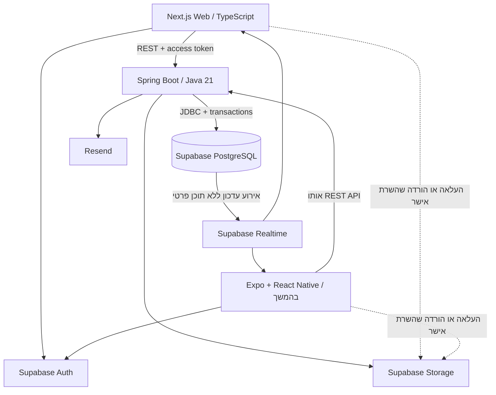

# ארכיטקטורת פלטפורמת שיתוף הפעולה בפרויקטים

מסמך עבודה מיום 5 באוקטובר 2026. הוא מתרגם את הגרסה האחרונה של הרעיון לתכנון טכני שאפשר לפתח לפיו. מקור דרישות המוצר הוא הקובץ ״רעיון לאפליקציה בישראל.pdf״, בעיקר עמודי PDF ‏53–87. במסמך המקורי אלה עמודים 68–102. הבחירות הטכנולוגיות שהוצעו בשיחה נשמרות כאן; פרטים שלא הוכרעו מסומנים כהמלצות או כהחלטות פתוחות.

המערכת מאפשרת לאדם לפרסם פרויקט ותחומים שבהם הוא מחפש שותפים, ולאדם אחר לבדוק את הפרויקט, להציג את הרקע שלו, לשוחח ולהצטרף בהסכמה. ההשתתפות יכולה להיות ממוקדת, מתמשכת או גמישה. קורות חיים וצ׳אט אישי הם חלק מהגרסה הראשונה לפי ההערות האחרונות של המשתמש.

## הבסיס מהשיחה והחידודים החדשים

| רכיב | הכיוון בגרסה האחרונה | פירוט מומלץ לבנייה |
| --- | --- | --- |
| אתר | React, TypeScript, Next.js | App Router, עמודים ציבוריים ורכיבים אינטראקטיביים לפי הצורך |
| אפליקציה בהמשך | Expo, React Native, TypeScript | לקוח נוסף של אותו API; שיתוף חוזה API וקוד שאינו תלוי בממשק |
| שרת | Java 21, Spring Boot | יישום אחד המחולק למודולים לפי תחומי המוצר |
| נתונים | PostgreSQL ב־Supabase | מודל רלציוני, אילוצים, אינדקסים ו־SQL migrations |
| התחברות | Supabase Auth | Google ודוא״ל; אימות JWT ב־Spring Security |
| קבצים | Supabase Storage | תמונות ציבוריות בנפרד מקורות חיים פרטיים |
| צ׳אט | Supabase Realtime, עם אפשרות לגישה ישירה להודעות | המלצה חדשה: כתיבת הודעות דרך Spring; Realtime להעברת אירועי עדכון |
| פריסה | Docker, Google Cloud Run | שירות web ושירות api; מגבלות משאבים וחיבורים למסד |
| אוטומציה | GitHub Actions | בדיקות, בנייה, migrations ופריסה מדורגת |
| שירותים משלימים | Resend, PostHog, Sentry | דוא״ל, מדדי שימוש ותקלות; צמצום נתונים אישיים שנשלחים אליהם |

החידוד לגבי כתיבת הודעות הוא המלצה חדשה שלי, ולא החלטה שכבר אושרה בשיחה. הסיבה היא שחסימה, הגבלת קצב, בדיקת משתתפים ושליחה חוזרת יכולים לקבל כללי התנהגות אחידים בשרת. אפשר עדיין ליישם את חלופת הכתיבה הישירה ל־Supabase, אך אז צריך לאכוף את אותם הכללים גם באמצעות RLS ואילוצי SQL.

## השפות והכלים לכל שכבה

| שכבה | שפה | כלים | מה היא עושה |
| --- | --- | --- | --- |
| ממשק האתר | TypeScript, TSX, CSS | React, Next.js, Tailwind CSS | תצוגה, טפסים, ניווט, התאמה לטלפון, עברית ו־RTL |
| טפסים ונתוני לקוח | TypeScript | React Hook Form, Zod, TanStack Query | אימות קלט בממשק, טעינה, שגיאות ועדכון נתוני השרת |
| שרת | Java 21 | Spring Boot, Spring MVC, Spring Security, Bean Validation | כללי מוצר, הרשאות ופעולות עסקיות |
| גישה לנתונים | Java ו־SQL | Spring Data JPA, Hibernate, PostgreSQL JDBC, HikariCP | שאילתות, עסקאות, חיבורים למסד ומיפוי נתונים |
| שינוי מסד | SQL | Flyway | יצירת טבלאות, שינוי סכמות, אינדקסים, grants, policies ו־triggers |
| חוזה API | OpenAPI, JSON | springdoc-openapi, OpenAPI Generator | תיעוד endpoints ויצירת לקוח TypeScript |
| התחברות | TypeScript ו־Java | supabase-js, @supabase/ssr, OAuth2 Resource Server | התחברות, ניהול session ואימות אסימון בשרת |
| צ׳אט בזמן אמת | TypeScript ו־SQL | Supabase Realtime Broadcast | עדכון לקוחות אחרי שינוי שנשמר במסד |
| אפליקציה עתידית | TypeScript ו־TSX | Expo, React Native, Expo Router | ממשק לטלפונים, deep links ו־push |
| תשתית | Dockerfile, YAML וקובצי תצורה | Docker, Cloud Run, GitHub Actions | אריזה, סביבות ופריסה |
| בדיקות עתידיות | Java ו־TypeScript | JUnit, Testcontainers, Playwright | כללי מוצר, עסקאות ותהליכים בין משתמשים |

Java היא שפת השרת. JavaScript דרך Node.js נדרשת גם להפעלת Next.js וכלי הבנייה, אך אין כאן שרת עסקי נוסף ב־Node. SQL הוא חלק משמעותי מהפרויקט, משום שאילוצי הנתונים וההרשאות אינם רק קוד Java.

TanStack Query מיועד לנתוני שרת בממשקים אינטראקטיביים. עמוד ציבורי יכול להיטען בשרת של Next.js. לא נכניס אותה אוטומטית לכל fetch, ולא נשכפל את אותם נתונים בכמה stores.

## מדיניות גרסאות

בשיחה הוצע Java 21 ואותו נשאיר כבסיס. בתיעוד שנבדק היום Spring Boot ‏4.1.1 תומך ב־Java 21. נבחר גרסת patch יציבה בעת ההקמה וננעל אותה ב־Maven Wrapper. Spring ינהל את גרסאות התלויות שהוא מכסה; תוספות ייבדקו מול גרסת Boot. [דרישות Spring Boot](https://docs.spring.io/spring-boot/system-requirements.html)

נשתמש ב־Node.js ‏24 LTS לפי סטטוס התמיכה שנבדק היום. גרסת המינימום של Next.js אינה המלצה להשתמש בגרסת Node שכבר הסתיימה תמיכתה. Next.js, React ו־pnpm יינעלו בעת ההקמה עם lockfile. [גרסאות Node.js](https://nodejs.org/en/about/previous-releases), [התקנת Next.js](https://nextjs.org/docs/app/getting-started/installation)

springdoc ‏3.x מתאים ל־Spring Boot ‏4. לא נעתיק dependency של springdoc ‏2.x ממדריך ישן לפרויקט Boot ‏4. גרסת PostgreSQL המקומית ובבדיקות תותאם לגרסה המנוהלת שנבחר ב־Supabase. [התאמת springdoc](https://springdoc.org/)

## מבנה המערכת



האתר והאפליקציה משתמשים באותם משתמשים, פרויקטים, שיחות והזמנות. Spring מחזיק את החלטות המוצר. Supabase מספקת שירותי תשתית מנוהלים. Next.js מטפל בהצגת האתר ובצורכי web כגון metadata, rendering ו־session; לוגיקה של קבלה לצוות תישאר בשרת המשותף.

החלוקה הפנימית של Spring היא Modular Monolith: שירות אחד לפריסה, עם גבולות בין תחומי אחריות. מודול אינו שרת נוסף. מודולים יפנו דרך שירותים או ממשקים מוגדרים במקום לערוך ישירות טבלאות שבאחריות מודול אחר. אפשר לבדוק את הגבולות באמצעות Spring Modulith או ArchUnit, לאחר בדיקת התאמת גרסאות. [מבנה מודולים ב־Spring](https://docs.spring.io/spring-modulith/reference/fundamentals.html)

## המודולים והאחריות שלהם

| מודול | אחריות | כלל מרכזי |
| --- | --- | --- |
| identity | חיבור זהות Supabase למשתמש מערכת, סטטוס חשבון | זיהוי המשתמש מתוך token מאומת |
| profiles | רקע, השכלה, כישורים, קישורים ומטרות למידה | משתמש מעדכן את הפרופיל של עצמו |
| projects | יצירה, עריכה, פרסום וארכוב | בעלות נבדקת לכל פעולה |
| collaborations | תחומים פתוחים, כישורים, היקף ומצב | תחום פתוח שייך לפרויקט אחד |
| recruitment | עניין, הזמנות והסכמה להצטרף | עניין ושיחה אינם חברות בצוות |
| teams | חברות, עזיבה והסרה | חברות נוצרת בעסקה לאחר קבלת הזמנה |
| messaging | שיחות, הודעות ומצב קריאה | הודעות נגישות רק לצדדים המורשים |
| files | קורות חיים, גרסאות קובץ ואישורי גישה | מסמך פרטי אינו חלק מהפרופיל הציבורי |
| contributions | תיאור תרומה ואישור בעל הפרויקט | הפרסום מתאר תרומה בפרויקט במדויק |
| notifications | התראות פנימיות, outbox ושליחת דוא״ל | פעולה נשמרת גם אם ספק הדוא״ל אינו זמין |
| moderation | דיווחים, חסימות וטיפול מנהל | דיווח אינו מוחק אוטומטית משתמש |

Builder ו־Contributor אינם הרשאות גלובליות מנוגדות. אותו משתמש יכול להחזיק פרויקט ולהצטרף לפרויקט אחר. Project owner הוא יחס לפרויקט; Admin הוא תפקיד מערכת נפרד.

## הישויות ומודל הנתונים

זהו מודל התחלתי מוצע. לפני כתיבת migrations נשרטט קשרים ואילוצים ונאשר את מקרי הקצה. נשמור רק שדות שצריך לצורכי V1.

| קבוצה | טבלאות מוצעות | נתונים וקשרים חשובים |
| --- | --- | --- |
| משתמשים | users, profiles | UUID התואם ל־sub המאומת; מצב החשבון; פרופיל ציבורי מוגבל |
| כישורים | skills, user_skills | CAN_CONTRIBUTE או WANT_EXPERIENCE, כדי להפריד בין ידע קיים למטרה |
| פרויקטים | projects, collaboration_roles, role_skills | בעלים, שלב המוצר, נושא, כותרת תחום, scope וכישורים |
| גיוס לצוות | interests, invitations, project_members | מי פנה, לאיזה תחום, מי הזמין ומי אישר |
| שיחות | conversations, conversation_participants, messages | קשר לבקשת עניין; שתי זהויות; הודעות ומצב קריאה |
| קבצים | file_assets, cv_access_grants | bucket ו־object path; בעל הקובץ; גרסה; הרשאה לבעל פרויקט מסוים |
| ניסיון | contributions, contribution_evidence | תיאור, תקופה, תחום, קישורים לתוצרים ואישור |
| תפעול | notifications, outbox_events, reports, user_blocks, audit_events | התראות, משלוח חוזר, חסימות ותיעוד פעולות רגישות |

הזדהות אינה מחייבת שמירת סיסמאות במסד שלנו. החיבור בין משתמש ל־Supabase נשען על זהות מאומתת; תהליך סגירת חשבון צריך לטפל גם במצב החשבון המקומי. נפריד DTO ציבורי מפרטים פרטיים ולא נחזיר JPA entities ישירות ללקוח.

אילוצים ראשוניים: מפתחות זרים, הגבלת אורך תכנים, enum או CHECK לערכים מוגדרים, בקשת עניין פעילה אחת למשתמש ולתחום, שתי רשומות משתתפים ייחודיות לשיחה, חברות צוות ללא כפילות ו־client_message_id ייחודי לשולח ולשיחה. אם נגדיר מכסת מקומות לתחום, קבלת המקום האחרון חייבת להיבדק בתוך transaction.

למיון הודעות נשתמש בסדר שקובע השרת, לדוגמה sequence עולה. לכל משתתף נשמור last_read_sequence. זאת המלצה שמחליפה את read_at היחיד שהופיע בדוגמת הנתונים בשיחה; היא מקלה על ספירת unread ותומכת בשימוש מכמה מכשירים.

## מצבי התהליך

נפריד מצבים של ישויות שונות כדי שמילה כגון Accepted לא תייצג כמה דברים שונים.

| ישות | מצבים מוצעים | משמעות |
| --- | --- | --- |
| פרויקט | DRAFT, PUBLISHED, ARCHIVED | טיוטה אינה מופיעה בחיפוש הציבורי |
| תחום פתוח | OPEN, PAUSED, CLOSED | עצירת גיוס אינה מוחקת משתתפים |
| עניין | SUBMITTED, ACKNOWLEDGED, DECLINED, WITHDRAWN, CLOSED | ACKNOWLEDGED פירושו שבעל הפרויקט התחיל לטפל בפנייה |
| שיחה | ACTIVE, CLOSED | חסימת אדם נבדקת בנוסף למצב השיחה |
| הזמנה | PENDING, ACCEPTED, DECLINED, CANCELLED, EXPIRED | רק הנמען רשאי לקבל את ההזמנה |
| חברות | ACTIVE, LEFT, REMOVED | עזיבה אינה מוחקת את תיעוד התרומה |
| תרומה | DRAFT, SUBMITTED, VERIFIED | VERIFIED דורש אישור ותנאי פרסום מוגדרים |

הכלל החשוב: התחלת שיחה, אישור פנייה או צפייה בקורות חיים אינם מצרפים אדם לצוות. בעל הפרויקט שולח הזמנה; הצד השני מאשר; השרת יוצר חברות. המערכת גם אינה מעניקה גישה ל־GitHub, Firebase או Figma של הפרויקט. הצדדים מסדירים זאת בכלים שלהם.

## התחברות והרשאות

Supabase Auth מטפל ב־Google ובדוא״ל. נבחר שיטת דוא״ל אחת ל־V1 בעת ההקמה, כדי לא לבנות כמה מסלולים מיותרים. Next.js משתמש בלקוחות SSR/Browser של Supabase לפי ההקשר; Spring מקבל access token ומאמת אותו מול issuer ו־JWKS של הפרויקט, עם expiry, audience ואלגוריתם חתימה מותאם. `sub` הוא מקור זהות המשתמש, ולא userId שהלקוח שולח בגוף הבקשה. [Spring Security JWT](https://docs.spring.io/spring-security/reference/servlet/oauth2/resource-server/jwt.html), [מפתחות חתימה של Supabase](https://supabase.com/docs/guides/auth/signing-keys)

JWT תקין מעיד על זהות, לא על הזכות לערוך פרויקט מסוים. Spring בודק בעלות, השתתפות ומצב חשבון מול הנתונים העדכניים. כך גם חשבון שנחסם אינו ממשיך לבצע פעולות רק משום שהאסימון עדיין בתוקף.

ב־Next.js בדיקת session ותפריט מוסתר משפרים חוויה, אך הרשאה נאכפת גם בנקודת הגישה לנתונים. Supabase מתעדת שימוש ב־getClaims לאימות זהות בשרת ומזהירה מהסתמכות על user מתוך getSession ומ־caching של תשובות הכוללות session. נפריד cache ציבורי מנתונים אישיים; בשלב הראשון אפשר להתחיל עם public rendering דינמי כדי לצמצם מורכבות. [Supabase SSR](https://supabase.com/docs/guides/auth/server-side/nextjs), [Next.js Authentication](https://nextjs.org/docs/app/guides/authentication)

טבלאות עסקיות יישמרו בסכמה שאינה חשופה ל־Data API של הלקוח. חיבור JDBC של Spring ישתמש בתפקיד runtime ייעודי עם הרשאות נחוצות בלבד. migrations יבוצעו בזהות נפרדת. RLS לא מחליף בדיקות Spring בחיבור JDBC, ואסור להניח שה־JWT של בקשת HTTP מופיע אוטומטית ב־auth.uid() במסד.

## קורות חיים וקבצים

קורות חיים יישמרו ב־bucket פרטי. תמונת פרופיל ולוגו יוכלו להיות ציבוריים אחרי ולידציה. הלקוח מבקש רשות להעלות, השרת קובע object path שאינו בשליטת משתמש אחר, ולאחר העלאה מאמת ומקשר את הקובץ. המלצת V1 היא PDF בלבד לקורות חיים, עם מגבלת גודל מוגדרת, למשל 5 MB. זהו ערך תכנון שנבדוק מול נפח האחסון.

דרישת המוצר שאושרה היא צירוף קורות חיים בכל הגשה: המשתמש שומר כמה קבצים בהגדרות ובוחר קובץ אחד לפנייה המסוימת. קישור GitHub הוא תוספת לבחירה. התכנון הטכני המוצע שומר את הקובץ שנבחר ואת הרשאת הצפייה לבעל הפרויקט המסוים, ומחזיר קישור הורדה קצר חיים לאחר בדיקה. מנגנון החלפת קבצים ושמירת גרסאות יפורט בהמשך בהתאם לכללי המוצר שיאושרו.

משיכת פנייה, ביטול שיתוף או חסימה יכולים למנוע הנפקת קישור חדש. קישור שכבר הונפק יכול להישאר תקף עד תפוגתו, וקובץ שכבר הורד אינו ניתן למשיכה. לכן נשמור תפוגה קצרה, לא נרשום URLs חתומים בלוגים, ונבהיר למשתמש למי הוא משתף. [אחסון והרשאות](https://supabase.com/docs/guides/storage/security/access-control), [URLs חתומים](https://supabase.com/docs/guides/storage/serving/downloads)

קובץ קורות חיים חובה בכל הבעת עניין. הדרישה מתייחסת להגשת מועמדות; הרשמה וגלישה אינן דורשות צירוף קובץ. סוגי הקבצים המותרים ומגבלת הגודל עדיין מוצעים בתכנון. קורות החיים נשארים פרטיים, והפנייה מצרפת רק את הקובץ שהמשתמש בחר.

## הצ׳אט בפירוט

בשיחה האחרונה הוצע לאפשר כתיבת הודעות ישירות ל־Supabase עם RLS. החידוד המומלץ כאן הוא:

1. Spring יוצר שיחה רק בעקבות פנייה תקפה ובחירת בעל הפרויקט להתחיל לדבר.
2. הלקוח שולח הודעה ל־Spring עם מזהה שיחה ו־client_message_id.
3. השרת בודק השתתפות, חשבון פעיל, חסימה, אורך וקצב; שומר הודעה ב־transaction.
4. trigger שולח אירוע Realtime לערוץ פרטי של השיחה. האירוע מכיל מזהה וסדר, ללא גוף ההודעה.
5. הלקוח מקבל אירוע ומבקש את ההודעות החדשות דרך API מאובטח.
6. לאחר ניתוק, הלקוח משלים הודעות מהמסד לפי הסמן האחרון. Realtime אינו ההיסטוריה.

Supabase ממליצה כיום על Broadcast עבור שינויי מסד. לערוצים פרטיים יש מדיניות הרשאות נפרדת על realtime.messages; הרשאת SELECT על טבלת הודעות אפליקטיבית אינה מספיקה בפני עצמה. [Database Changes](https://supabase.com/docs/guides/realtime/subscribing-to-database-changes), [Realtime Authorization](https://supabase.com/docs/guides/realtime/authorization)

הרשאות ערוץ מחושבות בעת ההתחברות. לכן נבדוק חסימה וביטול הרשאה גם עם socket שכבר פתוח. אירוע ללא גוף הודעה מגביל חשיפה של תוכן כאשר לקוח נדרש לרענן הרשאה; ה־API ממשיך לאכוף את המצב העדכני. כלל התכנון לחסימה הוא עצירת הודעות חדשות, התעניינות והזמנות חדשות וביטול שיתוף CV חדש; נכריע בנפרד בשמירת ההיסטוריה ובהסתרתה.

הצ׳אט הראשון כולל טקסט, סדר, timestamp, מצב שליחה ו־unread. הסדר וה־timestamps נקבעים בשרת. אין צורך ב־WebSocket נוסף ב־Spring. הזמנה לצוות היא פעולה עסקית נפרדת מהודעות, כדי שניתן יהיה לבדוק קבלה כפולה, ביטול והסכמה.

## חוזה API והמסכים

| מסך | פעולות API מרכזיות מוצעות |
| --- | --- |
| גילוי | GET /v1/projects, GET /v1/collaborations עם filters ו־pagination |
| עמוד פרויקט | GET /v1/projects/{slug}; הפרדה בין נתונים ציבוריים למידע של הבעלים |
| הפרופיל שלי | GET/PATCH /v1/me/profile; ניהול כישורים ומטרות |
| ניהול פרויקט | POST/PATCH לפרויקטים ולתחומים; publish, pause, close |
| התעניינות | POST /v1/collaborations/{id}/interests; withdraw ו־owner review |
| שיחה | יצירת שיחה מאושרת, GET/POST messages, PATCH read-cursor |
| הצטרפות | POST invitations; POST invitation accept/decline |
| צוות | GET members; POST leave; פעולת הסרה לבעלים |
| קורות חיים | בקשת upload, finalize, רשימת גרסאות ו־download מאושר |
| התרומה שלי | כתיבה, submit, owner verify ופרסום מבוקר |
| התראות | GET notifications, mark-read |
| בטיחות | reports, blocks; ממשק נפרד למנהל |

זהו קטלוג תכנון, לא חוזה endpoint שכבר הוטמע. OpenAPI יתעד בקשות, DTO, שגיאות והרשאות. נייצר ממנו לקוח TypeScript במקום לשמור טיפוסים ידניים כפולים. שגיאות יקבלו code קבוע, הודעה, שדות שגויים ו־requestId. לא נחשוף stack traces. [springdoc](https://springdoc.org/), [TypeScript Fetch Generator](https://openapi-generator.tech/docs/generators/typescript-fetch/)

## חיפוש וביצועים

חיפוש ראשון ישלב תחום, skill IDs, שלב פרויקט ו־scope, עם חיפוש טקסט ב־PostgreSQL. נבחר text configuration לאחר בדיקת עברית ואנגלית; אין להניח שחיפוש אנגלי מספק ניתוח לשוני בעברית. בשלב ראשון אפשר להסתפק בחיפוש מילים פשוט ובסינון מובנה, ולבחון תוצאות עם המשתמשים.

נבנה pagination בכל feed והיסטוריית הודעות, ונתכנן אינדקסים לפי שאילתות אמיתיות: בעל פרויקט, תחום פתוח, skills, פניות פעילות ושיחה לפי סדר. נבדוק EXPLAIN כשיש צורך. אין כרגע הצדקה להוסיף Redis, Elasticsearch או מערכת matching מורכבת.

חיבור JDBC ישתמש ב־HikariCP קטן וב־SSL. ב־Cloud Run נבדוק Session Pooler כבסיס עם PostgreSQL JDBC, ולא נבחר transaction pooling רק משום שהשירות יכול לרדת לאפס. transaction mode דורש התאמות ובהן prepared statements; JDBC משתמש ב־prepareThreshold=0 במקרה הזה. [חיבורים ו־pooling](https://supabase.com/docs/guides/database/connecting-to-postgres)

תקציב חיבורים מחושב בקירוב כ־מספר instances כפול pool size, בתוספת migrations ושירותי Supabase. מגבלות גודל ו־max instances ייקבעו מתוך התקציב, כולל מרווח ל־deployments ולחריגות זמניות. המספרים ייקבעו לאחר מדידה בסביבת בדיקה.

## התראות ותפעול

notifications ו־outbox_events ייווצרו יחד עם הפעולה העסקית. עדכון צוות אינו תלוי בזמינות Resend. worker מבצע ניסיון שליחה, שומר תוצאה ומנסה שוב בשגיאות זמניות עם idempotency. הבחירה הראשונה המוצעת היא Job מתוזמן שמרוקן outbox; נבחן זמן תגובה ועלויות לפני הוספת queue מנוהל.

Cloud Run עם request-based billing אינו בסיס בטוח ל־thread או @Scheduled שצריך להמשיך לרוץ אחרי התשובה. אם נדרשת עבודה עצמאית, נשתמש ב־Cloud Run Job שמופעל באמצעות Cloud Scheduler, או נשנה במפורש את מודל ההפעלה. זו תוספת תפעולית לתוכנית המקורית, עם עלות שצריך לחשב. [כללי עבודה ברקע ב־Cloud Run](https://docs.cloud.google.com/run/docs/tips/general), [תזמון Jobs](https://docs.cloud.google.com/run/docs/execute/jobs-on-schedule)

הגבלת קצב לא תסתמך רק על זיכרון של instance, משום שכמה instances יכולים לפעול יחד. לבטא אפשר להחזיק תקציב פעולות למשתמש ב־PostgreSQL עם עדכון אטומי. נפריד מגבלות של פניות, הודעות והעלאות, ונקבע ערכים אחרי ניסוי. מגבלות Auth יוגדרו בנוסף אצל הספק. זו המלצת מימוש בסיסית; לא נוסיף Redis רק לצורך ההתחלה.

דוא״ל התחברות מגיע מ־Supabase Auth דרך SMTP מוגדר. דוא״ל מוצר מגיע מ־Spring דרך Resend. לפני בטא נגדיר דומיין שולח ונבדוק delivery; שירות הדוא״ל המובנה של Supabase אינו מיועד לפריסה רגילה למשתמשים. [Custom SMTP](https://supabase.com/docs/guides/auth/auth-smtp), [Java ו־Resend](https://resend.com/docs/send-with-java)

PostHog יקבל אירועי משפך כגון interest_submitted, conversation_started, invitation_accepted ו־contribution_verified. Sentry יקבל תקלות. לא נשלח להם גופי הודעות, תוכן CV או URLs חתומים. בתחילת הדרך נעדיף מדידה מפורשת על איסוף אוטומטי גורף.

## מבנה המאגר והסביבות

```text
Connections/
  apps/
    web/                     Next.js
    mobile/                  יתווסף כשנגיע לשלב המובייל
  packages/
    api-client/              לקוח וטיפוסים שנוצרים מ־OpenAPI
    design-tokens/           צבעים, מרווחים וערכי עיצוב משותפים
  backend/
    api/                     Spring Boot עם Maven Wrapper
      src/main/resources/db/migration/
  infrastructure/            Docker ופרטי פריסה
  supabase/                  תצורה מקומית לשירותים המנוהלים
  docs/                      ארכיטקטורה, החלטות ותוכנית עבודה
  .github/workflows/          CI ופריסה
```

השם Connections הוא שם תיקיית העבודה, ולא שם מוצר שנבחר. pnpm workspaces ישמש את חלקי TypeScript; Maven ינהל את Java. לא נכניס את Java למנהל החבילות של Node. Expo תומכת ב־workspaces, אך נבדוק תאימות React ופתרון dependencies כשנוסיף mobile. [Expo Monorepos](https://docs.expo.dev/guides/monorepos/)

מקומית נריץ שירותי Supabase באמצעות CLI ו־Docker. Flyway יהיה המקור היחיד ל־DDL של המוצר; לא נערוך במקביל את אותה טבלה גם ב־Supabase migrations וגם ב־Flyway. התצורה של Supabase אינה סכמת מוצר נוספת. ב־local ניתן להריץ Flyway בעת ההפעלה; בסביבות פריסה נבצע migrations בצעד מבוקר ונשתמש ב־schema validation בשרת. [Supabase Local Development](https://supabase.com/docs/guides/local-development), [Spring Database Initialization](https://docs.spring.io/spring-boot/how-to/data-initialization.html)

יהיו local, staging ו־production, עם כתובות, OAuth callbacks וסודות נפרדים. Cloud Run יריץ images של web ו־api. ב־GitHub Actions נעדיף Workload Identity Federation לפריסה ל־Google Cloud; סודות אחרים יישמרו במנהל סודות לפי הצורך. [פריסת Java ל־Cloud Run](https://docs.cloud.google.com/run/docs/quickstarts/build-and-deploy/deploy-java-service), [זהות לפריסות](https://docs.cloud.google.com/iam/docs/workload-identity-federation-with-deployment-pipelines)

## התאוששות ועלויות

נבדוק שחזור מסד לפני הבטא, ונגדיר מי מטפל בגיבוי ובתקלות. גיבוי מסד Supabase אינו כולל את תוכן הקבצים ב־Storage; קורות חיים ותמונות דורשים מדיניות גיבוי או יכולת שחזור נפרדת. נגדיר גם תקופת שמירה והליך סגירת חשבון. [גיבויים ב־Supabase](https://supabase.com/docs/guides/platform/backups)

נכון לבדיקה היום Supabase Pro מתחיל ב־$25 לחודש; העלות בפועל תלויה גם במספר הפרויקטים, compute ותוספות. local ו־staging אינם בהכרח כלולים בעלות של production. Resend Free מציג 3,000 הודעות לחודש ו־100 ליום. [Supabase Pricing](https://supabase.com/pricing), [Resend Pricing](https://resend.com/pricing)

לא נבטיח עלות כוללת של $0–10. Cloud Run מתומחר לפי אזור ומשאבים, והוצאות build, אחסון images, תעבורה ושירותים נוספים יכולות להיות נפרדות. תקציב התחלתי לתכנון בלבד הוא עשרות דולרים לחודש, ויאומת אחרי פריסת הניסוי. נגדיר התראות חיוב, max instances, מדידת cold start ומיקום קרוב למסד. התראת תקציב אינה חסימה אוטומטית של חיוב. [Cloud Run Pricing](https://cloud.google.com/run/pricing), [מגבלת instances](https://docs.cloud.google.com/run/docs/configuring/max-instances), [תקציבים והתראות](https://docs.cloud.google.com/billing/docs/how-to/budgets)

## החלטות שצריך לסגור לפני מימוש מלא

1. סוגי קובצי קורות חיים, מגבלת גודל ומדיניות החלפה ושמירת גרסאות; חובת צירוף בכל פנייה ושמירת כמה קבצים בהגדרות אושרו.
2. מי רשאי לפרסם פרויקט ומהי מדיניות פרויקטים מסחריים.
3. שיטת התחברות בדוא״ל והשפה הראשונה של הממשק.
4. האם לאמץ את ההמלצה לכתיבת הודעות דרך Spring או את חלופת הכתיבה הישירה מהשיחה.
5. האם לכל תחום מספר מקומות מוגדר, ומה קורה כשהגיוס נסגר.
6. תנאי צפייה בהיסטוריית שיחה וב־CV אחרי משיכת פנייה, חסימה ועזיבה.
7. היקף אישור התרומות בבטא וזכויות הצגת התוצרים.
8. תקציב, סביבות ואזורי אחסון ופריסה.

אפשר לתכנן ולבנות בסיס טכני עם ההמלצות המתועדות כאן. ההחלטות האלה צריכות להיות מפורשות לפני שמקבעים את ההתנהגות של המשתמשים בקוד.
